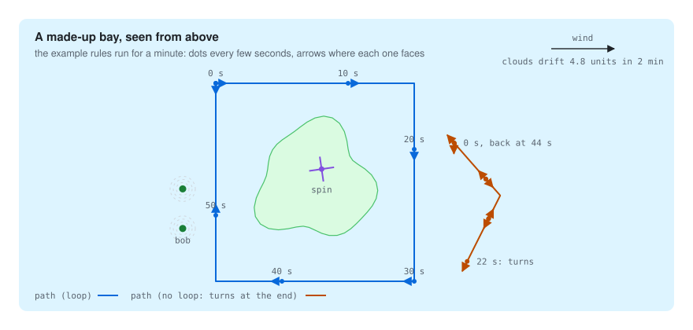

<div align="center">

# Go motion simulator

**The motions of a living scene, as a plugin for [go-simulator](https://github.com/akrck02/go-simulator).**
The day passes, the wind gusts, clouds drift, the tide rises and falls, and whatever asks for it in
its properties bobs, spins or follows a path, in real time while you watch the 3D scene.

[](go.mod)


</div>

## 🤖 AI disclosure

I write most of my code by hand, so I want to be clear about this project: **it was written by an
AI assistant (Claude, by Anthropic) under my direction.** I decided what to build and how it should
behave; the code, the tests and the documentation were written by the AI. Every commit made this
way carries a `Co-Authored-By: Claude` line (all of them).

**Status: pending thorough review.** The code compiles and its tests pass, but I have not yet
reviewed it line by line. Treat it as a working draft, not as code I vouch for.

---

<p align="center">
  
</p>

<p align="center"><sub>The example rules on a made-up bay, drawn from what the plugin itself answered.</sub></p>

## ✨ What it looks like

<p align="center">
  
</p>

<table>
<tr>
<th width="33%">bob</th>
<th width="33%">spin</th>
<th width="33%">path</th>
</tr>
<tr>
<td>Floats up and down with a slight roll, like a boat. Neighbours take different phases, so they do not move together.</td>
<td>Turns around a local axis, like a mill's sails.</td>
<td>Follows points facing where it goes; loops, or turns around at the end.</td>
</tr>
</table>

<p align="center">
  
</p>

## 🚀 Quick start

Clone [go-simulator](https://github.com/akrck02/go-simulator) and go-renderer next to this
repository, then show a glTF scene with the example rules:

```bash
cd ../go-simulator
go run ./cmd/simulator -rules ../go-simulator-motion/examples/living-scene.yaml scene.glb
```

**T** turns the day cycle on, **M** turns the tides off and on, **P** pauses, **,** and **.** halve
or double the speed of time. A scene asks for an entity's motion in its glTF node extras:

```json
{ "name": "boat", "extras": { "bob": { "height": 0.5, "period": 4, "roll": 0.05 } } }
```

[More on getting started →](docs/3-getting-started.md)

## 🔍 How it works

<p align="center">
  
</p>

go-simulator keeps the world and moves the clock; every frame it gives the plugin's rules one step
of that many seconds. The plugin reads its copy of the world and answers with changes to the
environment and to entities' transforms; it never touches the renderer.
[More on how it works →](docs/5-how-it-works.md)

## 📚 Documentation

| | |
|---|---|
| [The motion quest](docs/2-the-quest.md) | Make a village feel alive in 5 levels. |
| [Getting started](docs/3-getting-started.md) | Running the example, the keys, asking for motions in a scene, the tests. |
| [Motions](docs/4-the-model.md) | What every rule moves and the properties entities use, with pictures. |
| [How it works](docs/5-how-it-works.md) | How the plugin fits go-simulator, and how the rules are stepped over time. |
| [Rules reference](docs/6-rules-reference.md) | Every rule and parameter, generated from the plugin's own description. |

## Licence

The repository has no licence file yet.
