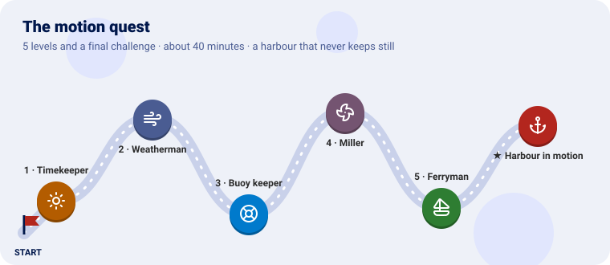
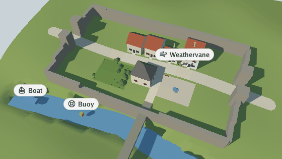
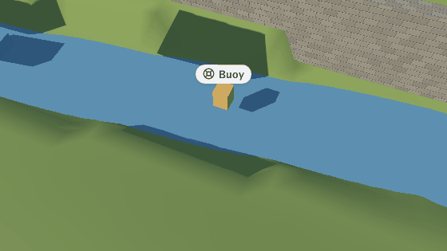
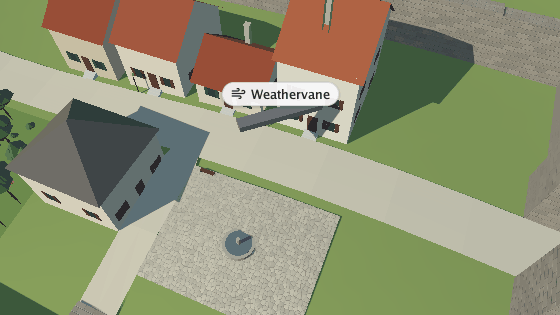
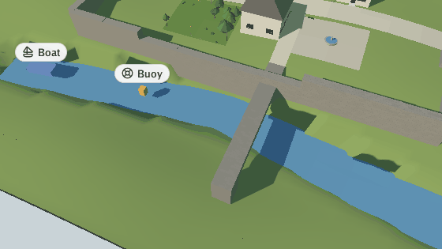
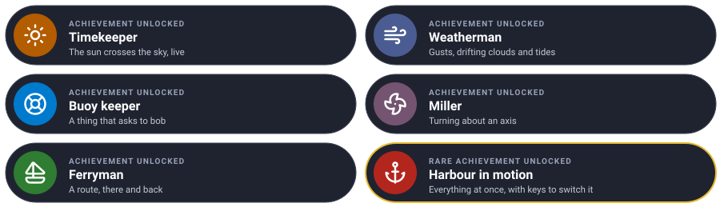

# The motion quest

Make a still scene feel alive, one level at a time. Each level teaches one piece of the motion
plugin and ends with something moving in the viewer.



We take the village of [Go Scene Builder's quest](https://github.com/akrck02/go-scene-builder/blob/master/docs/2-the-quest.md)
(any `.glb` works) and make it move: the day passes, the wind gusts, a buoy bobs on the river, a
weathervane turns and a boat sails a route. You write a tiny plugin of your own that puts the buoy,
the vane and the boat in the world; the motion plugin moves them.

---

Every level has the same shape: **the idea** (explained with something from everyday life), **the
rules**, a **checkpoint** to know it works, and an optional **bonus**.

---

## Before you start

You need Go 1.25 and GEOS (`sudo apt install libgeos-dev`, `brew install geos`). Clone the projects
side by side and make a folder with a scene in it:

```sh
git clone https://github.com/akrck02/go-renderer
git clone https://github.com/akrck02/go-scene-builder
git clone https://github.com/akrck02/go-simulator
git clone https://github.com/akrck02/go-simulator-motion
mkdir lively && cd lively
cp ../village/village.glb .
```

Everything here runs **live**, in Go Simulator's viewer:

```sh
go run ../go-simulator/cmd/simulator -rules rules.yaml village.glb
```

The motion rules belong on a `realtime` clock: they follow the seconds you watch, and the viewer's
**P** (pause) and **,** **.** (slower, faster) apply to them. The animations below were made with
the same rules on a stepped clock of half-second steps, captured with `-advance`.

---

## Level 1 · The Timekeeper

| Mission | Pieces | Time |
|---|---|---|
| The day passes in two minutes | `day_cycle`, a real-time stage, a toggle key | 5 min |

#### The idea

The sun does not move: the **earth turns**, and the sun seems to circle round the sky's pole. The
`day_cycle` rule turns it round the pole once every `seconds_per_day`; the renderer works out day,
twilight and night from how high it is, and the stars and the moon follow.

#### Build it

`rules.yaml`:

```yaml
plugins:
  - name: motion
    command: [go, run, .]
    directory: ../go-simulator-motion

stages:
  - name: harbour
    clock: realtime
    rules:
      - {rule: day_cycle, with: {seconds_per_day: 120}, toggle_key: T}
```

#### Checkpoint

The shadows turn, the light goes gold, the village falls into night and the sun comes up again,
every two minutes. **T** stops the day where it is, and starts it again.



#### Bonus (optional): a slow afternoon

<details>
<summary>🔓 Show the solution</summary>

`seconds_per_day: 600`, or press **,** to halve the speed of time.

</details>


Learn more: [Motions: the environment](4-the-model.md#the-environment)

---

## Level 2 · The Weatherman

| Mission | Pieces | Time |
|---|---|---|
| Wind that gusts, clouds that drift, a sea that rises and falls | `gusts`, `cloud_drift`, `tides` | 5 min |

#### The idea

Real wind is never steady: it **breathes**, stronger and weaker, swinging a little either way. The
`gusts` rule varies the wind the scene started with, as a sum of three slow waves that never quite
repeat; plants made to sway bend with it, and `cloud_drift` moves the clouds along it. `tides`
turns the tide's clock, about twice a day, if the scene has a tide.

Each rule only changes what the scene already has: no wind in the scene, no gusts.

#### Build it

```yaml
      - {rule: gusts, with: {variation: 0.5, veering: 0.35}}
      - rule: cloud_drift
      - {rule: tides, with: {seconds_per_day: 120}, toggle_key: M}
```

#### Checkpoint

The garden's trees sway harder and softer; if the sky has clouds they drift with the wind. The
village has no tide (its river has no tidal grid); a scene with one, such as Go Renderer's sample
island, rises and falls, and **M** stops it.

#### Bonus (optional): a storm

<details>
<summary>🔓 Show the solution</summary>

`variation: 0.9, veering: 0.8`: the wind changes wildly in strength and swings far.

</details>


---

## Level 3 · The Buoy keeper

| Mission | Pieces | Time |
|---|---|---|
| A buoy that bobs on the river | `entity_motion`, `bob`, a plugin that adds things | 10 min |

#### The idea

The motion plugin moves **things that ask to be moved**: an entity with a `bob` property bobs, one
with `spin` spins, one with `path` follows a route. It does not care who put the thing there: a
node of the scene, or another plugin. It is like a **dance teacher** who teaches whoever comes to
the class with a dance card.

So we write the smallest plugin there is: it adds three things, each with its card, and does
nothing else.

#### Build it

`props/go.mod`:

```
module example.com/props

go 1.25.6

require github.com/akrck02/go-simulator v0.0.0

replace (
	github.com/akrck02/go-simulator => ../../go-simulator
	github.com/akrck02/go-renderer => ../../go-renderer
	github.com/akrck02/go-scene-builder => ../../go-scene-builder
)
```

`props/main.go`:

```go
// Command props is a tiny plugin that puts things in the harbour for the motion plugin to move: a
// buoy that bobs, a weathervane that spins and a boat on a route. It only adds them, once; motion
// reads their properties and moves them.
package main

import (
	"log"

	"github.com/akrck02/go-simulator/plugin"
	"github.com/akrck02/go-simulator/protocol"
	"github.com/akrck02/go-simulator/spatial"
	"github.com/akrck02/go-simulator/world"
)

type props struct{}

var propsRule = plugin.Definition{
	Description: protocol.RuleDescription{
		Name:      "props",
		Summary:   "Adds a buoy, a weathervane and a boat that ask the motion plugin to move them.",
		Writes:    []string{"prop"},
		Publishes: []protocol.OutputDescription{plugin.Kind("prop", "a thing that asks for a motion")},
	},
	New: func(plugin.Parameters) (plugin.Rule, error) { return &props{}, nil },
}

func (rule *props) Start(context *plugin.Context) error {
	buoy := spatial.Translation(spatial.Vector{-0.02, 0.0115, 0.026})
	context.Add(&world.Entity{Identifier: "buoy", Kind: "prop", Transform: &buoy,
		Shape:      &world.Shape{Primitive: "box", Size: spatial.Vector{0.0015, 0.002, 0.0015}, Color: &[4]float32{0.9, 0.5, 0.1, 1}},
		Properties: map[string]any{"label": "Buoy", "icon": "life-buoy", "bob": map[string]any{"height": 0.0006, "period": 3, "roll": 0.1}}})

	vane := spatial.Translation(spatial.Vector{0.018, 0.028, -0.01})
	context.Add(&world.Entity{Identifier: "vane", Kind: "prop", Transform: &vane,
		Shape:      &world.Shape{Primitive: "box", Size: spatial.Vector{0.008, 0.0006, 0.0012}, Color: &[4]float32{0.2, 0.2, 0.2, 1}},
		Properties: map[string]any{"label": "Weathervane", "icon": "wind", "spin": map[string]any{"axis": []any{0, 1, 0}, "speed": 1.5}}})

	boat := spatial.Identity()
	context.Add(&world.Entity{Identifier: "boat", Kind: "prop", Transform: &boat,
		Shape: &world.Shape{Primitive: "box", Size: spatial.Vector{0.003, 0.0015, 0.007}, Color: &[4]float32{0.2, 0.35, 0.7, 1}},
		Properties: map[string]any{"label": "Boat", "icon": "sailboat",
			"path": map[string]any{"points": []any{[]any{-0.05, 0.0115, 0.0295}, []any{0, 0.0115, 0.0215}, []any{0.05, 0.0115, 0.0315}}, "speed": 0.004, "loop": false}}})
	return nil
}

func (rule *props) Step(*plugin.Context) error { return nil }

func main() {
	log.SetFlags(0)
	harbour := &plugin.Plugin{Name: "props", Version: "0.1.0", Rules: []plugin.Definition{propsRule}}
	if err := harbour.Serve(); err != nil {
		log.Fatal(err)
	}
}
```

Positions are in the scene's kilometres, `[x, y, z]`, with z growing to the south. Then
`cd props && go mod tidy && cd ..`, and in `rules.yaml` a second plugin and two rules:

```yaml
plugins:
  - {name: motion, command: [go, run, .], directory: ../go-simulator-motion}
  - {name: props, command: [go, run, .], directory: props}
…
      - rule: props
      - rule: entity_motion
```

#### Checkpoint

An orange buoy on the river rises and falls every three seconds, rocking a little, with its label.
(The vane and the boat move too: the next two levels are about them.)



#### Bonus (optional): a row of buoys

Add three more, a few metres apart. They bob out of step on their own: the phase comes from where
each one is.

<details>
<summary>🔓 Show the solution</summary>

<pre><code>for index := 1; index &lt;= 3; index++ {
	place := spatial.Translation(spatial.Vector{-0.02 + float32(index)*0.008, 0.0115, 0.026})
	context.Add(&amp;world.Entity{Identifier: world.Identifier(fmt.Sprint("buoy-", index)), Kind: "prop", Transform: &amp;place,
		Shape:      &amp;world.Shape{Primitive: "box", Size: spatial.Vector{0.0015, 0.002, 0.0015}, Color: &amp;[4]float32{0.9, 0.5, 0.1, 1}},
		Properties: map[string]any{"bob": map[string]any{"height": 0.0006, "period": 3}}})
}</code></pre>

</details>


Learn more: [Motions: entities](4-the-model.md#entities)

---

## Level 4 · The Miller

| Mission | Pieces | Time |
|---|---|---|
| A weathervane that turns | `spin` | 4 min |

#### The idea

A mill's sails, a weathervane, a wheel: things that **turn about an axis** from where they rest.
`spin` gives the axis in the thing's own frame (`[0, 1, 0]` is upright) and the speed in radians a
second (6.3 is a turn a second).

#### Build it

The vane in `props/main.go` already asks for it:

```go
"spin": map[string]any{"axis": []any{0, 1, 0}, "speed": 1.5}
```

#### Checkpoint

Over the high street, a dark bar turns about itself, a little more than a quarter turn a second.



#### Bonus (optional): a mill's sails

<details>
<summary>🔓 Show the solution</summary>

Lay the axis flat, `"axis": []any{0, 0, 1}`: it turns like sails facing south.

</details>


---

## Level 5 · The Ferryman

| Mission | Pieces | Time |
|---|---|---|
| A boat that sails a route and comes back | `path`, `loop` | 4 min |

#### The idea

A **bus route**: a list of stops, a speed, and either a loop (back to the first stop, round again)
or there-and-back. `path` places the thing on the route at a steady speed, turned to face where it
goes; `"loop": false` brings it back the way it came.

#### Build it

The boat in `props/main.go`:

```go
"path": map[string]any{"points": []any{[]any{-0.05, 0.0115, 0.0295}, []any{0, 0.0115, 0.0215}, []any{0.05, 0.0115, 0.0315}}, "speed": 0.004, "loop": false}
```

4 metres a second, along the river, under the bridge.

#### Checkpoint

The blue boat sails east along the river, under the bridge, and some 25 seconds later turns back.




---

## Final challenge · Harbour in motion

All of it at once in one real-time stage, and a key for each part: **T** the day, **G** the gusts,
**B** the boats and buoys. Start with the day stopped, so the village opens in daylight.

> **Hint:** every rule takes a `toggle_key`, and `enabled: false` starts it switched off.

<details>
<summary>🔓 Show the solution</summary>

<pre><code>plugins:
  - {name: motion, command: [go, run, .], directory: ../go-simulator-motion}
  - {name: props, command: [go, run, .], directory: props}

stages:
  - name: harbour
    clock: realtime
    rules:
      - rule: props
      - {rule: day_cycle, with: {seconds_per_day: 120}, enabled: false, toggle_key: T}
      - {rule: gusts, with: {variation: 0.5, veering: 0.35}, toggle_key: G}
      - rule: cloud_drift
      - {rule: entity_motion, toggle_key: B}</code></pre>

</details>


---

## Well done



The village lives: its day turns, its wind breathes, and things you added move as they were asked.

### Ideas to keep going

| Idea | Difficulty | Hint |
|---|---|---|
| Motions in the scene itself | ⭐ | glTF node extras become properties: `"extras": {"bob": {…}}` ([getting started](3-getting-started.md)) |
| A ferry that counts its trips | ⭐⭐ | Go Simulator's [quest](https://github.com/akrck02/go-simulator/blob/main/docs/2-the-quest.md) |
| A town that grows while the day turns | ⭐⭐⭐ | A stepped stage with the [urban plugin](https://github.com/akrck02/go-simulator-urban) beside this real-time one |

## Troubleshooting

| You see | Why, and what to do |
|---|---|
| Nothing moves | The rule is off (`enabled: false`, or its key pressed), or the stage is not `realtime` and has no `pace` |
| The day does not change | The scene has no sun direction: scenes from Go Scene Builder have one |
| No gusts | The scene starts with no wind: give it one in the scene's environment |
| The buoy floats in the air or is buried | Its height (`0.0115`) is in scene kilometres: move it a little up or down |
| An entity bobs instead of following its path | An entity takes one motion: bob wins over spin, spin over path |

---

[← All the documentation](1-overview.md)
