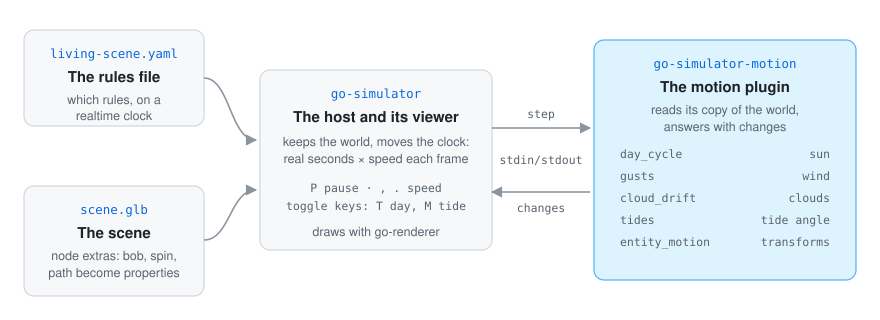
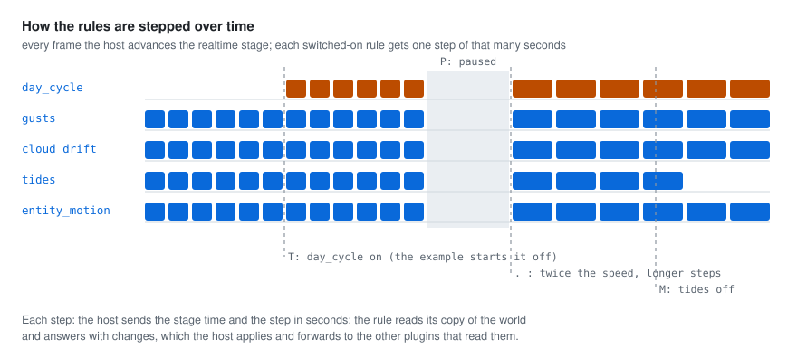

# 🔍 How it works

## How the plugin fits go-simulator

  

go-simulator is the host. It loads the scene, keeps the world (its entities and its environment)
and moves the clock. The motion plugin is a separate program the host starts; they talk over
standard input and output (go-simulator's [protocol](https://github.com/akrck02/go-simulator/blob/main/docs/protocol.md)).

- At the start the plugin **describes** itself: its five rules, their parameters, what each one
  reads and what it writes. That description is also where the [rules reference](rules.md) comes from.
- The four environment rules read the environment and write `environment`: the sun direction, the
  wind, the clouds' offset and the tide angle.
- `entity_motion` reads only the entities with a `bob`, `spin` or `path` property and writes
  `transforms`.

A plugin never touches the renderer: it reads its copy of the world and answers with changes
(go-simulator's [writing plugins](https://github.com/akrck02/go-simulator/blob/main/docs/writing-plugins.md)).
The renderer then draws the sky, the sway of plants, the clouds and the water from the environment,
and the entities where their transforms put them. Shapes are in world units and fields in physical
units, as go-simulator's [vocabulary](https://github.com/akrck02/go-simulator/blob/main/docs/vocabulary.md) lists.

## How the rules are stepped over time

  

The example's rules are on a `realtime` clock. Every frame the viewer advances that stage by the
seconds that passed, times the speed:

- Each switched-on rule gets one **step**: the host sends the stage time and the step in seconds,
  the rule reads its copy of the world and answers with changes. The host applies them and forwards
  them to any other plugin that reads them.
- **Pause** (`P`) sends no steps; the motions stop where they are.
- **Speed** (`,` `.`) makes the steps shorter or longer, so everything moves slower or faster
  together.
- A **toggle key** turns its rule off or on. A rule that is off is not stepped at all: the tide
  stays at its angle, and the day cycle in the example waits for `T`.

The rules work in rates, not frames: the sun turns `2π × step / seconds_per_day`, the tide
`2π × step / period`, a path moves `speed × step`. So a slow and a fast computer show the same
scene after the same time. `gusts` and `entity_motion` keep their own count of the seconds they
have been stepped, so a rule switched off and on again picks up where it stopped.

## How the pictures were made

The pictures in these pages that show motion (the bay at the top of the README, the strips, the sky
and the clouds, and the three entity panels) were drawn from the plugin's own answers. A small
throwaway program, kept outside the repository, ran the real plugin in a go-simulator host with
`examples/living-scene.yaml`, switched the day cycle on with `T` as the viewer would, put a made-up
bay in the world (a ferry on a looping path, a skiff on one that goes out and back, two buoys that
bob, a mill that spins), advanced the clock 0.1 seconds at a time for two minutes, and drew where
everything was.

They are SVG drawings with their own light and dark colours, not screenshots of the viewer: the
repository has no example scene whose entities ask for a motion, and the look of the sky and the
water is the renderer's work, not this plugin's. The diagrams (how it fits, the two kinds of
motion, the steps over time) were drawn by hand in the same style.
