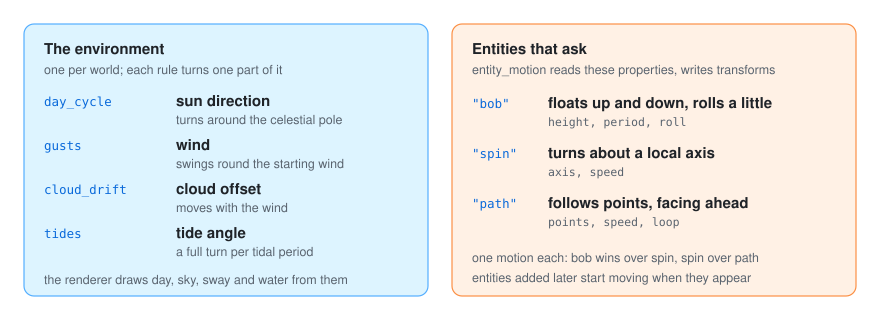
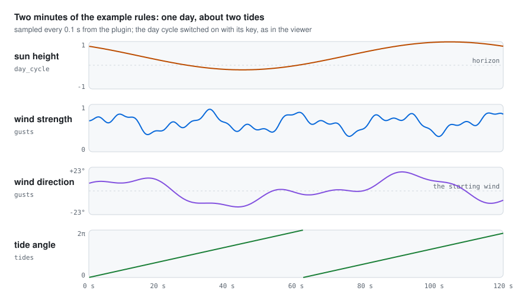
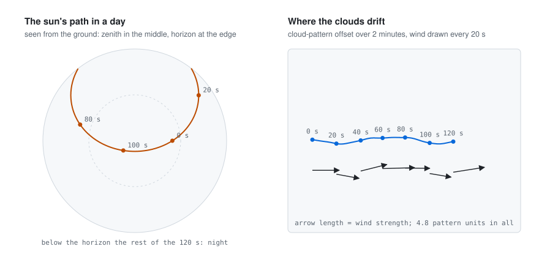
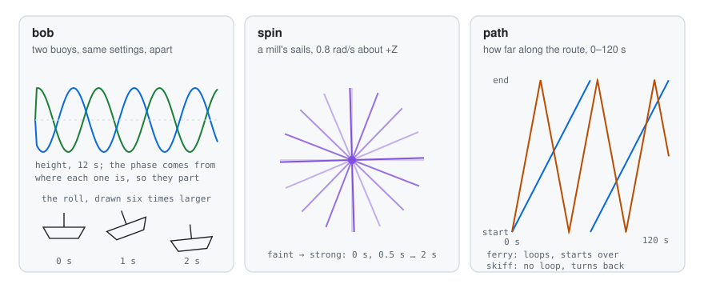

# 🌊 Motions

A still scene feels like a photograph. The motion plugin makes it feel alive: the sun crosses the
sky, the wind picks up and dies down, clouds drift past, the sea rises and falls, boats bob and mill
sails turn. It works in real time, while you watch the 3D scene. It changes the environment (sun,
wind, clouds, tide) and the transforms of entities that ask for a motion. Its rules belong on a
`realtime` clock; the speed keys of the viewer (`,` `.`) and the pause (`P`) apply to them.

<p align="center">
  
</p>

## The environment

| Rule | What it does |
|---|---|
| `day_cycle` | Turns the sun around the celestial pole once every `seconds_per_day` (120); the stars follow it, and the renderer derives day, twilight and night from the sun's height |
| `gusts` | Varies the wind's strength (`variation`, 0.5) and direction (`veering`, 0.35 rad) around the wind the world started with; plants marked to sway bend with it and clouds drift |
| `cloud_drift` | Moves the clouds with the wind (`speed`, 0.05) |
| `tides` | Turns the tide angle a full turn per period (`period_seconds`; 0 = 12.42 h in proportion to `seconds_per_day`). The tide's heights and phases come with the scene; the renderer raises the water from them |

Each rule only changes what the world already has: with no sun direction or celestial pole there is
no day cycle, with no wind there are no gusts, and so on.

<p align="center">
  
</p>

The strips above are two minutes of `examples/living-scene.yaml`, with the day cycle switched on by
its key. With `seconds_per_day: 120` the sun goes round once. The wind swings around where it
started and never quite repeats: it is a sum of three sines whose periods do not divide each other.
The tide period is the 12.42 hours of the principal lunar semidiurnal tide (known as M2: high water
twice a day, a little later each day), kept in proportion to the day, so 120 × 12.42 / 24 ≈ 62 seconds.

<p align="center">
  
</p>

The sun turns around the celestial pole, so it rises, climbs and sets along an arc; the rest of the
day it is below the horizon. The clouds move with the wind, faster when it blows harder: at
no wind at all they still creep, at 0.2 × `speed`, and at strength 1 they move at 1.2 × `speed`.

## Entities

`entity_motion` moves the entities that ask for it in their properties. glTF node extras arrive as
properties, so a scene can ask for motions without any code.

| Property | Motion |
|---|---|
| `"bob": {"height": h, "period": s, "roll": radians}` | Floats up and down with a slight roll (a boat) |
| `"spin": {"axis": [x, y, z], "speed": radians per second}` | Turns around a local axis (a mill's sails) |
| `"path": {"points": [[x, y, z], …], "speed": units per second, "loop": true}` | Follows the points facing where it goes (+Z forward); without `loop` it turns around at the end |

An entity takes one motion: bob wins over spin, spin over path. Entities added later by other
plugins start moving as soon as they appear: the rule reads entities with those properties.

What each key is when it is left out:

| Motion | Key | When left out |
|---|---|---|
| bob | `height` | 0.001 world units |
| bob | `period` | 4 seconds |
| bob | `roll` | 0.03 radians |
| spin | `axis` | `[0, 1, 0]`, upright |
| spin | `speed` | 1 radian per second |
| path | `speed` | 1 world unit per second |
| path | `loop` | `true` |

<p align="center">
  
</p>

- **bob** moves the entity up and down around where it rests and rolls it about its own X axis.
  The phase comes from where the entity is, so two buoys a little apart rise and fall out of step.
- **spin** turns the entity about an axis in its own frame, from where it rests.
- **path** places the entity on the route at a steady speed and turns it to face along the segment
  it is on. A loop goes back to the first point and starts over; without one, the entity comes back
  the same way. Where the entity rests is replaced by the route; its turn and scale are kept.

## Use

```bash
cd ../go-simulator
go run ./cmd/simulator -rules ../go-simulator-motion/examples/living-scene.yaml scene.glb
```

`examples/living-scene.yaml` runs the plugin with `go run`; after `go install` the command can be
just `[go-simulator-motion]`. During development go-simulator and go-renderer are used from the
folders next to this one (`replace` in `go.mod`). More in [getting started](getting-started.md).
